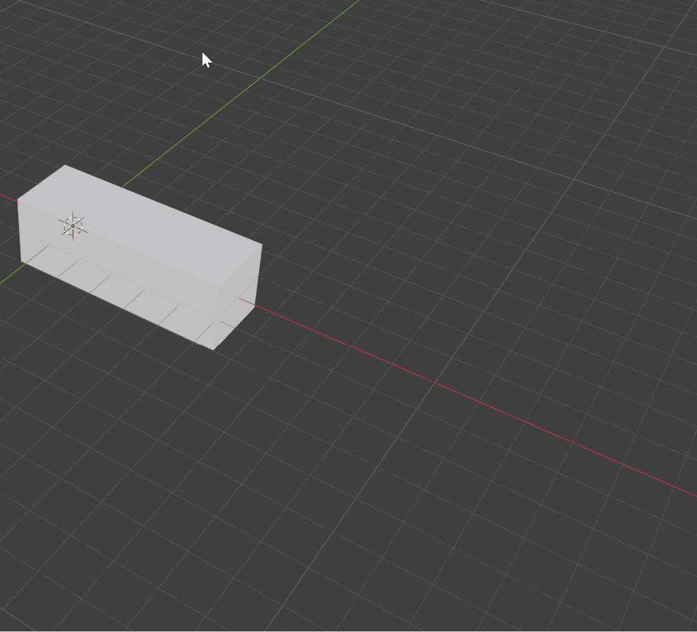
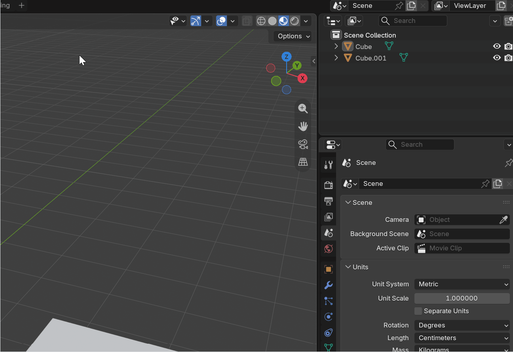
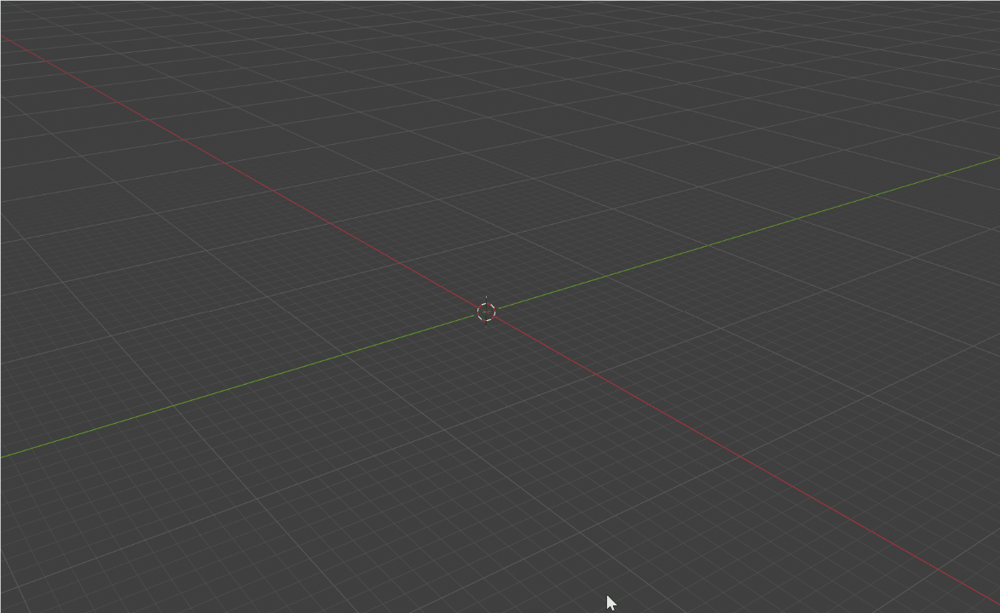

# 🧰 Alikz' 3D1 Toolkit

## ❓ About

This repository contains a bundle of tools tailored to making aspects of the **3D1** workflow faster, less tedious and less stressful.

> [!NOTE]
> If you encounter any problems or bugs, or want me to add a feature, don't hesitate to contact me on discord or anywhere else really.

> [!CAUTION]
> These tools are only to be used for the 3D1 course, since I cannot guarantee conventions in other courses will be the same.

## 📥 Installation

1. Navigate to the **[Releases](../../releases)** section on the right side of this repository.
2. Download the latest `Alikz-3D1-Toolkit.zip` file from the Assets section. *(Do not extract it!)*
3. Open Blender and go to `Edit > Preferences > Add-ons`.
4. Click the **Install...** button in the top right corner.
5. Locate your downloaded `.zip` file and click **Install Add-on**.
6. Check the box next to **3D View: Alikz' 3D1 Toolkit** to enable it!

## 🔧 Tools Overview

### **Sanity Checker (CTRL + SHIFT + V)**

Press the keybind anywhere inside the **3D Viewport** to instantly run a full sanity check on your scene.

 

  
   
  <em>Opening the Sanity Checker.</em>

 

#### 🔍 What it checks
The tool scans your file and flags issues across three main categories:

- **🏷️ Naming Conventions**
  * **Object Naming:** Flags objects missing the `SM_` prefix. *(Don't forget to also give them descriptive names!)*
  * **Material Naming:** Flags materials missing the `M_` prefix.

- **📐 Mesh & Topology**
  * **N-Gons:** Objects containing faces with more than 4 vertices.
  * **Non-Manifolds:** Objects with edges that are connected to more than 2 faces.
  * **Overlapping Geometry:** Objects containing overlapping/duplicate vertices.
  * **Unapplied Modifiers:** Objects that still have active modifiers in their stack.

- **🧹 Data Cleanup:**
  * **Unused Materials:** Materials sitting in the file with 0 users.
  * **Unused Textures:** Image blocks loaded into Blender but not plugged into any materials.
  * **PSD Textures:** Unexported Photoshop (`.psd`) files still linked in your materials. Make sure to replace these with your final exports.

#### 🖱️ Quick-Select Navigation

Items flagged with a gray background in the pop-up are interactive. Clicking them will automatically **select the offending object or material** in your viewport so you can fix it immediately.

 

  
   
  <em>Selecting an Object through the UI.</em>

 

Clicking anywhere outside of the pop-up will close it.

> [!IMPORTANT]
> **No auto-fixing.** This tool strictly identifies problems. It will not fix them for you, ensuring you remain actively engaged with solving the issues yourself.

> [!CAUTION]
> **What it CANNOT check:** A script cannot see art direction. You still need to manually check for proper **origin placement**, **good edge flow/topology**, **UV layout quality** and many more things. These can only be checked by you!

---

### **Fast Blueprints (CTRL + SHIFT + B)**

 

  
   
  <em>Generating references for Mike Wazowski</em>

 

Press the keybind to open the blueprint menu. From here, you can load your reference images for up to all 6 cardinal directions (Front, Back, Left, Right, Top, Bottom). Hit **OK**, and the add-on will instantly build your reference setup.

#### ⚡ What it automates:
- **Material Setup:** Automatically generates a new material for each image and wires up the texture nodes.
- **Orientation:** Spawns planes and perfectly rotates them to face the correct orthographic views.
- **Aspect Ratio:** Reads the pixel dimensions of your uploaded images and scales the planes to match, preventing stretched or squished references.

The imported blueprints are all moved into their own collection called `REF`.

> [!IMPORTANT]
> **Mind your scale!** Be sure to scale the blueprints to the desired size of your object after importing!

> [!NOTE]
> Make the `REF` collection non-selectable by toggling the arrow icon in your Outliner, that way you don't accidentally select the blueprints while working.
